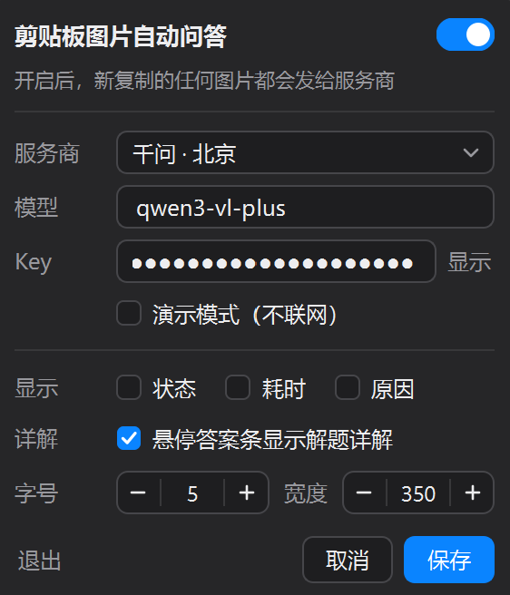

# SideMind

A tiny AI companion for your Windows taskbar.

SideMind turns an image copied to your clipboard into a short AI-assisted reference answer, without opening a chat window. It works with your existing screenshot tool and a vision-capable model of your choice.


## Screenshot

<p align="center">
  
</p>

*Settings flyout on Windows in dark mode, shown with customized display preferences. The API key is masked.*

## Features

- Use your existing screenshot shortcut; no additional screen capture tool is required.
- Compact taskbar-aligned answer display with a transparent background.
- Optional short explanations, response latency and status text.
- Optional hover card with step-by-step teaching notes, disabled by default.
- Relaunching the app can replace an existing instance through a user-restricted local IPC channel.
- Adjustable font size and display width, with a live preview on the taskbar.
- A compact settings flyout with light and dark themes.
- Bring your own API key: DeepSeek, Qwen or a custom OpenAI-compatible vision endpoint.
- Asynchronous requests, duplicate-image filtering and an offline demo mode.

SideMind is intended for lesson preparation, self-study and practice where AI assistance is allowed. Answers are references, not verified solutions.

## Getting started

**Requirements:** Windows, Python 3.12 and a screenshot utility that copies images to the clipboard. A centered Windows 11 taskbar with free space on the left works best.

Clone or download this repository, then run the following in its directory:

```powershell
py -3.12 -m pip install -r requirements.txt
```

Double-click `run.bat`, or run:

```powershell
py -3.12 main.py
```

The second command is useful for troubleshooting startup errors.

1. Press **Ctrl + Shift + 1** to open settings.
2. Choose a provider, enter your API key and select a model that accepts image input.
3. Enable automatic clipboard image Q&A and save.
4. Take a screenshot with your usual screenshot tool, making sure it copies the image to your clipboard.
5. Read the reference answer on the left side of the taskbar.

The current interface and default model prompts are in Simplified Chinese. English documentation is provided; English UI localization is not yet available.

### Shortcuts

| Shortcut | Action |
| --- | --- |
| Ctrl + Shift + 1 | Open settings, change configuration or exit |
| Ctrl + Shift + 2 | Pause or resume automatic image processing |

### Provider presets

| Provider | Base URL | Default model |
| --- | --- | --- |
| DeepSeek | `https://api.deepseek.com` | `deepseek-flash` |
| Qwen (Beijing) | `https://dashscope.aliyuncs.com/compatible-mode/v1` | `qwen3-vl-plus` |
| Qwen (Singapore) | `https://dashscope-intl.aliyuncs.com/compatible-mode/v1` | `qwen3-vl-plus` |
| Custom | User-configurable | User-configurable |

Presets are editable where applicable and do not guarantee model availability. Use an endpoint that accepts the OpenAI-compatible Chat Completions image message format. API access, model availability, pricing and image support depend on the provider and account.

To try the interface without an API key, enable demo mode. It returns a clearly marked fixed sample rather than analyzing your screenshot.

### Detailed explanations

Fast answer mode is the default. To request more context, enable the detailed explanation option in settings. The same API request then asks for a short reason and a roughly 100–200 Chinese-character step-by-step explanation.

Hover over an answer for about 220 ms to open the detail card. Move away to dismiss it, or click the answer bar to pin or unpin it. Clicking the card dismisses it. The longer response may increase latency and token usage. Previously saved preferences are retained.

The card is a normal desktop window and may be visible during screen sharing. It is not designed to evade recording or monitoring.

## Privacy and safety

**When automatic Q&A is enabled, every new clipboard image may be sent to the selected API provider, not just screenshots.** SideMind cannot reliably distinguish screenshots from other copied images. Pause processing before copying private or sensitive material.

- Automatic processing requires explicit activation in settings and can resume on subsequent launches if left enabled.
- Existing clipboard contents are not sent on startup. Text clipboard contents are not processed.
- Images are processed in memory; SideMind does not intentionally save screenshots or maintain a screenshot history.
- Keys are encrypted using Windows DPAPI for the current user and stored in local settings, not the repository. This does not protect against software running with access to the same user account.
- Optional environment variables: `DEEPSEEK_API_KEY`, `DASHSCOPE_API_KEY`, `SIDEMIND_API_KEY`.
- Requests go to the configured provider, whose data handling policies and fees apply. There is no SideMind-operated backend.
- AI-generated answers may be wrong. Do not use this tool in exams or assessments that prohibit AI assistance.

## Project layout

```text
main.py          Application, taskbar overlay, settings and clipboard events
ui_kit.py        Custom Qt widgets and theme styling
vision.py        OpenAI-compatible vision API client
secrets_win.py   Windows DPAPI credential protection
run.bat          Windows launcher
test_gui.py      GUI regression tests
test_vision.py   API client tests using mocks
```

## Development

Run the tests on Windows:

```powershell
py -3.12 -m unittest -v
```

The tests use an offscreen Qt platform and mock API requests. No real API key is required.

### Known limitations

- Windows only; not an official Explorer taskbar extension.
- The overlay assumes there is unused space on the left of the primary taskbar. Left-aligned icons, unusual taskbar configurations and multiple monitors may require adjustments.
- Clipboard-based image detection depends on your screenshot tool.
- Model response quality, response time and availability vary.
- Automated tests do not replace real desktop or provider integration testing.

## Contributing

Bug reports, small focused pull requests and suggestions are welcome. Please see [CONTRIBUTING.md](CONTRIBUTING.md). Never include private screenshots or API credentials in an issue or pull request.

## License

SideMind source code is available under the [MIT License](LICENSE). PySide6 and other dependencies retain their own licenses.
